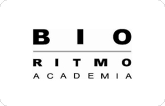
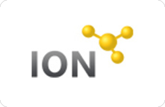
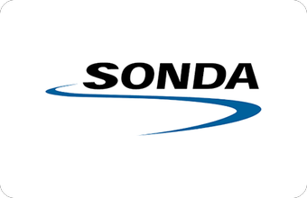
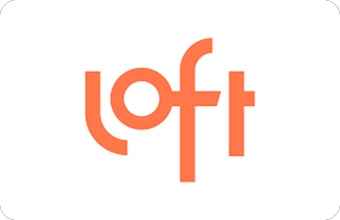
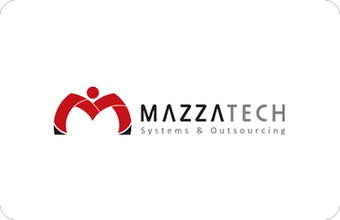
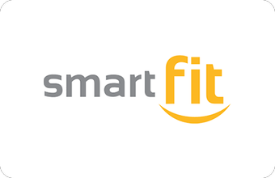
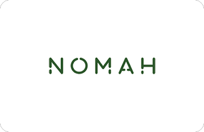
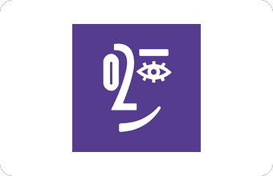

<!-- HEADER -->

 

---

## 👨‍💻 Sobre mim

Formado em **Tecnologia de Redes de Computadores**, atuo no mercado de tecnologia como **consultor e técnico de infraestrutura**, com serviços de **suporte, treinamento e consultoria** em novas tecnologias.

- 🛠️ Infraestrutura de desktops e servidores (Windows, Linux e macOS)
- ☁️ Cloud, virtualização e orquestração de ambientes
- 🔐 Hardening, automação e padronização via código
- 🎓 Treinamentos e consultoria para equipes de TI

---

## 🧰 Stack & Ferramentas

<table align="center">
  <tr>
    <td align="center"><b>🖥️ Sistemas Operacionais</b></td>
    <td>
      
    </td>
  </tr>
  <tr>
    <td align="center"><b>💻 Programação</b></td>
    <td>
      
    </td>
  </tr>
  <tr>
    <td align="center"><b>☁️ Cloud</b></td>
    <td>
      
    </td>
  </tr>
  <tr>
    <td align="center"><b>⚙️ Orquestração</b></td>
    <td>
      
    </td>
  </tr>
  <tr>
    <td align="center"><b>🗄️ Hypervisor</b></td>
    <td>
      
    </td>
  </tr>
  <tr>
    <td align="center"><b>🧩 Outras</b></td>
    <td>
      
    </td>
  </tr>
  <tr>
    <td align="center"><b>🎨 Design Gráfico</b></td>
    <td>
      
    </td>
  </tr>
</table>

---

## 🏢 Portfólio

Empresas e clientes que confiaram no meu trabalho
  

<table>
  <tr>
    <td align="center"></td>
    <td align="center"></td>
    <td align="center"></td>
    <td align="center"></td>
    <td align="center"></td>
  </tr>
  <tr>
    <td align="center"></td>
    <td align="center"></td>
    <td align="center"></td>
    <td align="center"></td>
    <td align="center"></td>
  </tr>
  <tr>
    <td align="center"></td>
    <td align="center"></td>
    <td align="center"></td>
    <td align="center"></td>
    <td align="center"></td>
  </tr>
</table>

---

## 📊 Atividade no GitHub

 

---

## 🎮 Vem jogar comigo

---

### 📬 Vamos conversar?

